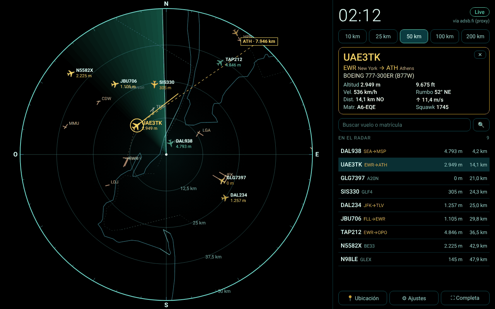
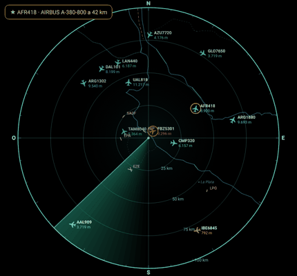
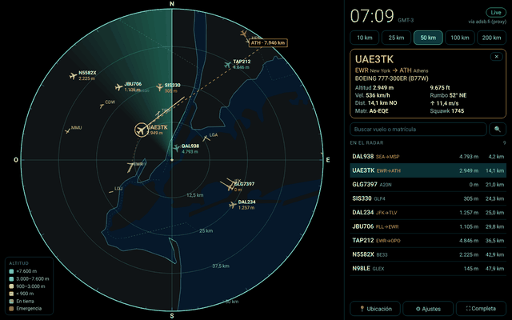

# 🛫 Radar de vuelos

Radar de aviones en vivo pensado para dejar prendido en una tablet: muestra los vuelos alrededor de tu ubicación con datos ADS-B reales, barrido animado a 60 fps y paleta en negro puro para pantallas OLED.

**App:** https://radar-vuelos-sigma.vercel.app · **Demo con datos simulados:** https://radar-vuelos-sigma.vercel.app/?demo



## Qué muestra

- Aviones en un radar circular con alcance de 10 a 200 km, coloreados por altitud (rojo = squawk de emergencia)
- Origen y destino de cada vuelo (ej. `ARG1633 · BRC → AEP`)
- **Mapa de fondo en cualquier lugar del mundo:** costa, ríos, límites de países y provincias (en Buenos Aires se ve el contorno de CABA), ciudades, aeropuertos y pistas reales con su ancho
- Estelas con el recorrido reciente y movimiento suave entre actualizaciones (se extrapola con velocidad y rumbo)
- Detalle al tocar un avión: tipo, matrícula, altitud, velocidad, rumbo, distancia, régimen vertical y squawk, más una línea con dónde va a estar en 2 minutos
- Referencias de AEP, EZE, San Fernando y El Palomar
- Lista de vuelos ordenada por distancia y reloj
- **Seguimiento de un vuelo:** el avión que tocás se sigue aunque aterrice, salga del radar o pierda la señal:
  - Ignora los filtros (lo ves aunque esté en tierra)
  - Avisa cuando aterriza o despega, indicando el aeropuerto
  - Si se aleja, muestra la distancia y un botón para ampliar el alcance; el proxy lo sigue buscando por su código aunque esté fuera del área
  - Si deja de transmitir, indica hace cuánto y atenúa el ícono; si se pierde, marca su última posición y cerca de dónde fue
  - Si vuelve a aparecer, lo retoma solo
- **Alertas** visuales y sonoras ante squawk de emergencia (7700/7600/7500) o cuando aparece algo de tu lista: tipos (A388, B748…), matrículas o aerolíneas
- **Filtros:** ocultar aviones en tierra o mostrar solo hasta cierta altitud
- **Modo noche** automático (23 a 7 por defecto): baja el brillo al 30% y oculta etiquetas
- Todo se configura desde **⚙ Ajustes** y queda guardado en la tablet
- La primera vez pide la ubicación del dispositivo; si no la dan, arranca en el Obelisco
- **Se actualiza sola:** cada 5 minutos se fija si hay una versión nueva publicada y recarga la página

| Buenos Aires (100 km) | Nueva York (50 km) |
|---|---|
|  |  |

## Cómo funciona

```
Tablet (index.html + app.js)  →  /api/aviones (Vercel, São Paulo)  →  adsb.fi / airplanes.live / adsb.lol
                              →  /api/rutas                      →  adsb.lol / adsbdb.com (rutas)
```

- **Frontend:** HTML + CSS + JavaScript sin frameworks ni build, compatible con navegadores viejos (probado para Chrome 106 / Android 6).
- **Proxy (`api/aviones.js`):** función serverless que consulta las APIs públicas en orden, con respaldo si una falla, normaliza la respuesta y la cachea unos segundos en el CDN para no pasarse de los límites de uso.
- **Rutas (`api/rutas.js`):** consulta la base de rutas de adsb.lol por callsign, con [adsbdb.com](https://www.adsbdb.com) de respaldo; se cachean una hora.
- **Mapa (`mapa/`):** 5.259 mosaicos estáticos de 2°×2° (11 MB en total). La app baja solo los de su zona (unos 12) y arma el fondo una vez. Se regeneran con `herramientas/generar_mapa.py` a partir de Natural Earth 1:10m y OurAirports.
- **Versión (`api/version.js`):** devuelve el commit publicado, para la actualización automática.
- La app pide datos cada 6 segundos. Las funciones corren en `gru1` (São Paulo) para menor latencia desde Argentina.

## Rendimiento (60 fps)

El radar son 5 canvas apilados que compone la GPU; solo uno se redibuja por cuadro:

| Capa | Se redibuja |
|---|---|
| Fondo (anillos, mapa, pistas, textos) | al cambiar tamaño, alcance o ubicación |
| Estelas | cuando llegan datos |
| Barrido | nunca: lo rota el compositor con una animación, sin JavaScript |
| Borde y puntos cardinales | al cambiar tamaño |
| Aviones | cada cuadro, con sprites y etiquetas pre-renderizadas |

Con el CPU frenado 6x, dibujar un cuadro con 80 aviones lleva unos 2 ms de JavaScript, sobre 16,6 ms de presupuesto.

## Pantallas redondas

En una pantalla cuadrada o redonda (por ejemplo una de 1080×1080 o 480×480) el radar ocupa todo el círculo y el panel lateral se reemplaza por controles dentro del radar: reloj y estado arriba, tarjeta del avión seleccionado abajo, y botones de alcance y ajustes. Tocar el alcance pasa al siguiente.

## Modo OLED

- Fondo y panel en `#000` (píxeles apagados).
- Cada 2 minutos toda la interfaz se desplaza 1–2 px para evitar que los elementos fijos se quemen en la pantalla.
- Con HTTPS usa la Wake Lock API para que la pantalla no se apague.

## Parámetros de URL

| Parámetro | Uso |
|---|---|
| `?lat=-34.60&lon=-58.38` | Centro del radar (por defecto: Obelisco). El botón 📍 lo toma del dispositivo y lo guarda. |
| `?km=50` | Alcance inicial |
| `?demo` / `?demo=80` | Datos simulados (con 80 aviones para prueba de carga) |
| `?fps` | Muestra fps y milisegundos por cuadro |
| `?redondo` / `?redondo=0` | Fuerza o apaga el modo pantalla redonda (se activa solo en pantallas cuadradas) |
| `?dpr=1` | Baja la resolución interna si el dispositivo no llega a 60 fps |

## Instalar en la tablet

1. Abrir la URL de la app en Chrome.
2. Menú ⋮ → **Agregar a pantalla principal**: queda en pantalla completa y horizontal.
3. Tocar **📍 Mi ubicación** una vez.

## Probar localmente

```bash
node servidor-local.js
```

Abrir http://localhost:3000 (datos reales) o http://localhost:3000/?demo.

## Deploy

Cada push a `main` se publica en Vercel. No hay build ni variables de entorno.

## Fuentes de datos

Mapa: [Natural Earth](https://www.naturalearthdata.com) y [OurAirports](https://ourairports.com) (dominio público).

Los datos de vuelos son de redes comunitarias de receptores ADS-B: [adsb.fi](https://adsb.fi), [airplanes.live](https://airplanes.live) y [adsb.lol](https://adsb.lol); las rutas, de adsb.lol y [adsbdb.com](https://www.adsbdb.com). Gracias a todos los que alimentan esas redes. Sus APIs son gratuitas y están pensadas para uso personal y no comercial: revisá sus condiciones antes de usar esto para otra cosa. La cobertura depende de la cantidad de receptores en cada zona.

## Licencia

El código está bajo licencia [MIT](LICENSE). La licencia no cubre los datos de terceros.
